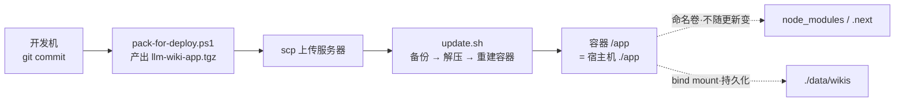
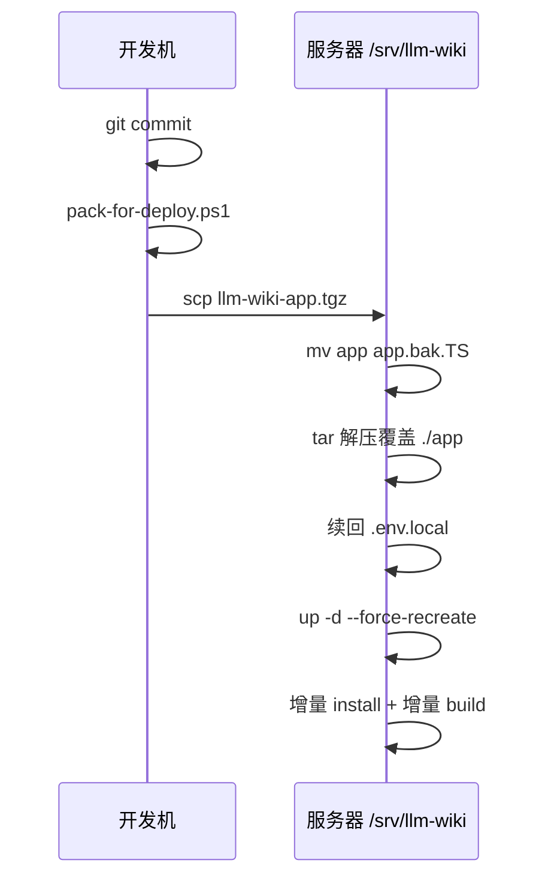

# 17 · 部署实施操作步骤（SOP）

> 面向**执行者**的逐条手册：命令 → 预期输出 → 失败怎么办。
> 「为什么这么设计」见 `docs/16-docker-deployment.md`，本文件只讲**怎么做**。
>
> 更新时间：2026-10-10 · 适用版本：llm-wiki 1.2.3

---

## 0. 心智模型（30 秒）



**一句话**：镜像只装运行时（Node 20 + pnpm + 依赖），**代码不在镜像里**。
更新 = 换宿主机 `./app` 的文件 + 重建容器，**永不重建镜像**（除非 `package.json` / lockfile 变了）。

---

## 阶段一 · 首次部署

### 步骤 1 — 服务器前置检查

```bash
docker --version && docker compose version
```

- 预期：`Docker version 20.10+` / `Docker Compose version v2.x`
- 若 `docker compose` 未知 → 安装 `docker-compose-plugin`，**别用老的 Python 版 `docker-compose`**。

```bash
ss -ltnp 2>/dev/null | grep 3737 || echo "3737 free"
df -h /var/lib/docker | tail -1          # 首次构建需 2~3 GB
curl -sS -o /dev/null -w "fonts:%{http_code}\n" --max-time 10 https://fonts.googleapis.com/
```

- `3737` 被占 → 改 `docker-compose.yml` 的**左侧**端口（如 `"8080:3737"`），右侧必须保持 `3737`。
- `fonts:000` / 超时 → **构建会失败**，见第 9 节「坑 A」两种解法（代理 或 改本地字体）。

> 服务器只需 Docker，**不需要** Node / pnpm / git。

---

### 步骤 2 — 开发机打包并上传（Windows PowerShell）

```powershell
cd E:\CodeRepository\CodeTest\llm-wiki
git add -A
git commit -m "release: <简述本次改动>"
.\pack-for-deploy.ps1
scp .\llm-wiki-app.tgz root@<服务器IP>:/srv/llm-wiki/
```

- 预期：`[pack] verified: N entries, kit + config present, no secrets` 然后 `[pack] done: ...`
- ⚠️ **未提交的改动不会被打包**，新建的 `Dockerfile` / `llm-wiki.config.json` 等也是"未跟踪"状态——**必须先 `git add -A && git commit`**，否则包里没有它们，而且构建时才会发现，白白浪费一轮部署。
- 打包天然排除 `node_modules/`、`.next/`、`wikis/`、`.env.local`（环境相关，绝不能进发布包）。
- 脚本自带**打包自检**：缺 `Dockerfile` / `docker-compose.yml` / `docker-entrypoint.sh` / `update.sh` / `llm-wiki.config.json` 任一，或混入密钥/原生依赖，都会**直接失败退出**，不会让你带着坏包上服务器。

手动复核（可选）：

```powershell
tar -tzf .\llm-wiki-app.tgz | Select-String -Pattern '^app/(Dockerfile|docker-compose\.yml|docker-entrypoint\.sh|update\.sh)$|^app/apps/web/llm-wiki\.config\.json$'
```

---

### 步骤 3 — 服务器解开代码 + 提取部署工具包

```bash
cd /srv/llm-wiki

# 3.1 解开源码到 ./app（压缩包内自带 app/ 顶层目录，故 --strip-components=1）
mkdir -p app
tar -xzf llm-wiki-app.tgz -C app --strip-components=1

# 3.2 把部署工具包提到部署根 —— 它必须活过 ./app 的整体替换
cp app/Dockerfile app/docker-compose.yml app/docker-entrypoint.sh app/update.sh /srv/llm-wiki/
cp app/.dockerignore /srv/llm-wiki/ 2>/dev/null || true
chmod +x update.sh

# 3.3 结构自检 —— 别省，路径错了后面全是玄学
ls app                                    # apps/ packages/ package.json pnpm-lock.yaml pnpm-workspace.yaml
ls app/apps/web/llm-wiki.config.json
ls Dockerfile docker-compose.yml docker-entrypoint.sh update.sh
```

> 若这里 `ls` 报 No such file → 说明开发机是**在提交之前**打包的（见步骤 2 的警告）。回去 commit 后重新打包。

---

### 步骤 4 — 写密钥（不进代码包，手工维护）

```bash
cat > /srv/llm-wiki/app/apps/web/.env.local <<'EOF'
CUSTOM_OPENAI_API_KEY=你的移动云key
ALIYUN_API_KEY=你的阿里云key
OPENROUTER_API_KEY=可选
EOF
chmod 600 /srv/llm-wiki/app/apps/web/.env.local
```

> 三个键名与 `apps/web/.env.example` 一致。非敏感配置（端口、端点、模型槽、默认产品）都在 `llm-wiki.config.json` 里，已随包发布。

---

### 步骤 5 — 建镜像 + 起容器

```bash
cd /srv/llm-wiki
docker compose up -d --build          # 首次 3~8 分钟
docker compose logs -f wiki           # Ctrl+C 退出跟随，不会停容器
```

预期日志：

```
[wiki-entrypoint] mode=prod node=v20.x pnpm=10.12.1
[wiki-entrypoint] reconciling dependencies
[wiki-entrypoint] building (incremental)
[wiki-entrypoint] starting: node .../next start -p 3737 -H 0.0.0.0
```

国内服务器若卡在字体下载：

```bash
docker compose build \
  --build-arg HTTP_PROXY=http://<proxy>:8080 \
  --build-arg HTTPS_PROXY=http://<proxy>:8080
docker compose up -d
```

---

### 步骤 6 — 验收自检

```bash
docker compose ps                                              # Up (healthy)，首次需等过 120s
curl -s http://127.0.0.1:3737/api/wikis/health                  # 返回 JSON，ok
curl -s http://127.0.0.1:3737/ | grep -o '<html lang="[^"]*"'    # <html lang="zh-CN">
docker compose logs --tail=100 wiki | grep -iE "error|MODULE_NOT_FOUND|EADDRINUSE" || echo clean
```

浏览器：`http://<服务器IP>:3737`（云服务器需放行安全组 / 防火墙 3737）。
**必看两项**：页面能打开（验证 HOSTNAME 坑已绕开）、切换 wiki 生效（上一轮 560/326 事故的直接回归点）。

---

### 步骤 7 — 迁移存量 wiki 数据（可选，推荐首次做）

容器里的 `wikis/` 初始为空，需要把现有产品库搬过去。

**开发机：**

```powershell
cd E:\CodeRepository\CodeTest\llm-wiki\apps\web\wikis
tar -czf ..\wikis-seed.tgz ConST560 ConST326     # 只打要搬的产品目录
scp ..\wikis-seed.tgz root@<服务器IP>:/srv/llm-wiki/
```

**服务器：**

```bash
cd /srv/llm-wiki
tar -xzf wikis-seed.tgz -C data/wikis
ls data/wikis                        # ConST560 / ConST326
docker compose restart wiki
```

或在界面/API 建空库后重新灌：`POST /api/wikis/init {"product":"ConST560","topic":"..."}`。
区别：拷目录＝**带数据搬迁**；init＝**建空库重灌**。

---

## 阶段二 · 日常更新

> 您的诉求：**代码改了，打包替换宿主机文件，重启容器**。就这三步。



### 开发机

```powershell
cd E:\CodeRepository\CodeTest\llm-wiki
git add -A && git commit -m "feat: ..."
.\pack-for-deploy.ps1
scp .\llm-wiki-app.tgz root@<服务器IP>:/srv/llm-wiki/
```

### 服务器

```bash
cd /srv/llm-wiki && ./update.sh ./llm-wiki-app.tgz
```

脚本自动做四件事：备份 `./app` → `app.bak.<时间戳>` → 解压覆盖 → 从备份续回 `.env.local` → 重建容器。

```bash
docker compose ps && docker compose logs -f wiki
```

**耗时**：纯逻辑改动通常 **30~90 秒**。

**两个「为什么」**：

| 选择 | 原因 |
| --- | --- |
| `--force-recreate` 而不是 `restart` | 备份用的是 `mv`，`./app` 已是**另一个 inode** 的新目录；部分 Docker 版本下 `restart` 复用原容器挂载命名空间继续读旧树 → **表现为更新没生效** |
| 不加 `--build` | 镜像不变，命名卷（`node_modules` / `.next`）全部保留 → install 是 no-op，build 走缓存，整体保持增量 |

---

## 阶段三 · 回滚

`update.sh` 结尾会打印带实际时间戳的命令，或手工：

```bash
cd /srv/llm-wiki
ls -d app.bak.*                      # 挑版本
rm -rf app && mv app.bak.<TS> app
docker compose up -d --force-recreate wiki
docker compose logs -f wiki
```

> 回滚只还原**代码**。若新版本改动过 wiki 数据（灌库、改页面），数据卷不会跟着回退——必要时从备份恢复 `./data/wikis`。

---

## 数据备份

```bash
# 备份（唯一有状态的东西）
tar -czf /srv/llm-wiki-backup-$(date +%F).tgz -C /srv/llm-wiki data

# 恢复
cd /srv/llm-wiki && tar -xzf backup.tgz && docker compose restart wiki
```

清理旧快照：`rm -rf /srv/llm-wiki/app.bak.<TS>`（保留最近 2~3 个即可）。

---

## 9 · 故障排查

| 症状 | 原因 | 处置 |
| --- | --- | --- |
| **坑 A** 构建卡住 / `Failed to fetch font` | `next/font/google` 构建期访问 Google Fonts，国内常不通 | ① `docker compose build --build-arg HTTP_PROXY=...`；② 或改用本地字体文件后重新打包 |
| **坑 B** 容器起来就崩，日志有 `getaddrinfo ENOTFOUND <十六进制串>` | Docker 注入的 `HOSTNAME=<容器ID>` 被 Next 当成绑定地址 | **代码已修**（`LLM_WIKI_HOST → config.server.host → 127.0.0.1` 并覆写 `HOSTNAME`）；若仍出现，检查 compose 的 `HOSTNAME` 是否被覆盖 |
| **坑 C** 更新后页面毫无变化 | 用了 `restart` 而非 `--force-recreate` | 用 `./update.sh`（内部已改）；或手工 `docker compose up -d --force-recreate wiki` |
| **坑 D** `ERR_DLOPEN_FAILED` / `NODE_MODULE_VERSION` | 宿主机 `node_modules` 被挂进容器（ABI 与 Node major 绑定） | 确认 5 个 `nm_*` 命名卷都在；**不要**把开发机 `node_modules` 打进发布包 |
| **坑 E** `lockfile is not up to date` / 容器反复重启 | 改了 `package.json` 或 `pnpm-lock.yaml` | 需重建镜像：`docker compose up -d --build` |
| **坑 F** 一直 `unhealthy` | 冷启动构建超过 `start_period: 120s` | `docker compose logs -f wiki` 确认在 build，完成后自动转 healthy |
| **坑 G** 端口不通 | 安全组 / 防火墙未放行 | 放行 3737（或你改的宿主机端口） |
| **坑 H** `update.sh: permission denied` | 上传丢失执行位 | `chmod +x update.sh` |

**看日志的常用命令：**

```bash
docker compose logs --tail=200 wiki              # 最近 200 行
docker compose logs -f --since 5m wiki           # 跟随最近 5 分钟
docker inspect llm-wiki --format '{{.State.Health.Status}}'
docker exec -it llm-wiki node -v                 # 确认容器内 Node 版本为 v20
```

---

## 10 · 何时必须重建镜像

| 变更内容 | 需要 `--build` 吗 |
| --- | --- |
| `apps/` `packages/` 下的业务代码 | ❌ 不需要，`./update.sh` 即可 |
| `llm-wiki.config.json` | ❌ 不需要（运行时读取） |
| `.env.local` 密钥变更 | ❌ 不需要（改完 `restart`，脚本会自动保留） |
| `package.json` / `pnpm-lock.yaml` | ✅ 需要 `docker compose up -d --build` |
| `Dockerfile` / `docker-entrypoint.sh` | ✅ 需要 `docker compose up -d --build` |
| `docker-compose.yml` | ✅ 需要 `docker compose up -d`（自动重建容器） |

---

## 11 · 相关文档

- `docs/16-docker-deployment.md` —— 设计原理、卷映射、三个坑的完整解释
- `docs/13-multi-wiki.md` —— 多 wiki 路由与优先级契约
- `../需求变更-01-配置固化与中英切换.md` —— 配置文件分层（`llm-wiki.config.json` + `.env.local`）
